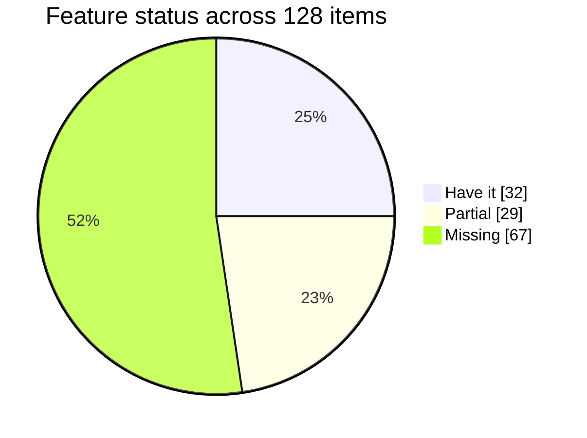
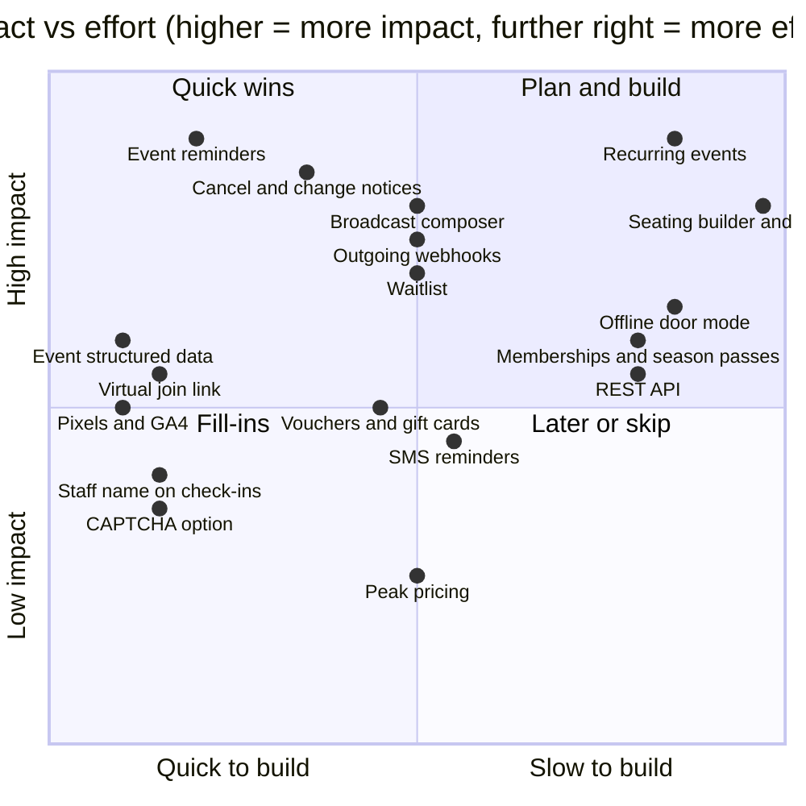
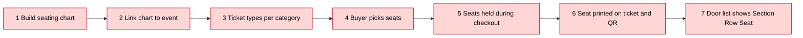
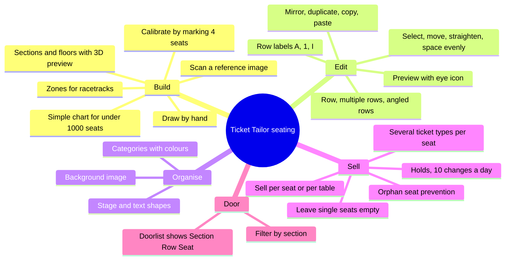
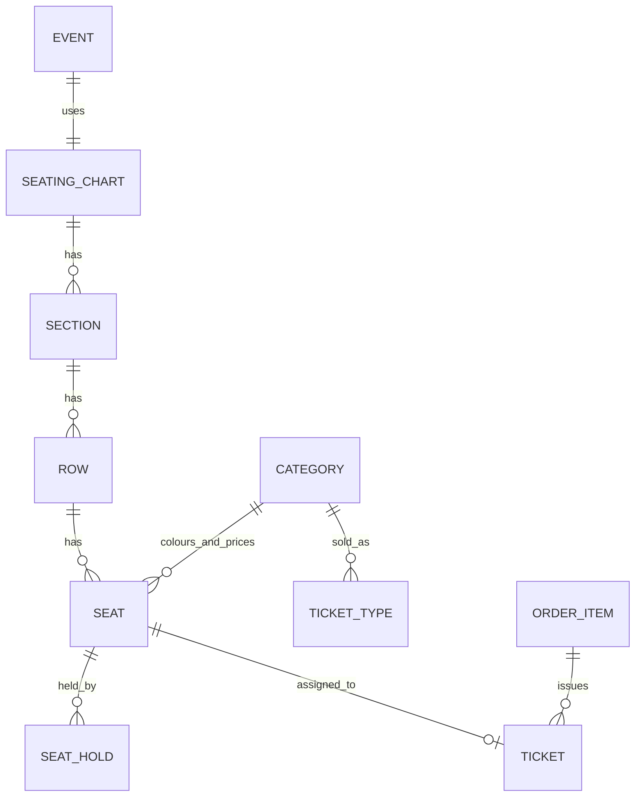
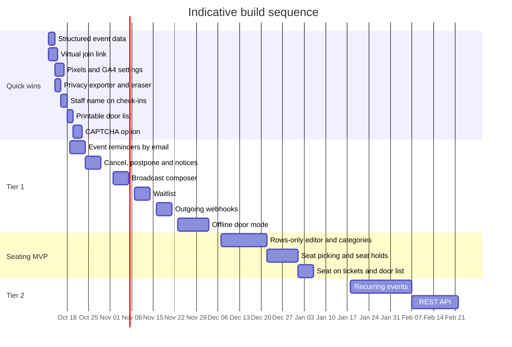

# SNN Tickets: improvement report vs Ticket Tailor

**For:** you, deciding what SNN Tickets should build next.
**Date:** 9 Oct 2026. **Our code:** `main` at 9075d16, clean tree when I started.
**Status legend:** ✅ we have it · 🟨 partial · ❌ missing · ❔ Ticket Tailor does not document it publicly

> **Visuals.** Mermaid diagrams render on GitHub and in VS Code with a Mermaid preview extension. If you see code blocks instead of charts, the text beside each chart has the same numbers.

---

## 0. Your venue question

**Yes, I under-reported venues.** My first report gave seating a single row, marked XL, and skipped most of what Ticket Tailor's seating tool does. Section 3 has the full picture.

On your examples:

- **Editing seat positions:** documented. They can drag rows, select several rows and move them, straighten them, space them evenly, mirror them, and duplicate or copy and paste sections.
- **Row micro-settings:** partly documented. Row labels can be alphabetical, numerical or Roman. The public help does **not** document seats-per-row counts, start numbers, numbering direction, or spacing values.
- **Individual seat edits, hiding or disabling a seat, aisle settings, accessible-seat flags, undo, and what happens after publishing:** not documented in their public help. I can't confirm these either way, so I list them as ❔ unknown, not missing.

To settle the unknowns, open a free Ticket Tailor box office, go to **Box office settings → Manage → Seating charts**, and try them. About 15 minutes.

---

## 1. Scorecard

### Overall (128 items)



| | Count | Share |
|---|---|---|
| ✅ Have it | 32 | 25% |
| 🟨 Partial | 29 | 23% |
| ❌ Missing | 67 | 52% |

### By area

| Area | Bar (🟩 have · 🟨 partial · 🟥 missing) | ✅ | 🟨 | ❌ | Have % |
|---|---|---|---|---|---|
| A. Tickets and selling | 🟩🟩🟩🟩🟩🟩🟨🟨🟨🟨🟨🟨🟨🟨🟨🟥🟥🟥🟥🟥🟥🟥🟥🟥🟥🟥🟥🟥🟥🟥🟥 | 6 | 9 | 16 | 19% |
| B. Event page and marketing | 🟩🟩🟨🟨🟨🟨🟨🟨🟥🟥🟥🟥🟥🟥 | 2 | 6 | 6 | 14% |
| C. Payments and money | 🟩🟩🟨🟨🟨🟨🟥 | 2 | 4 | 1 | 29% |
| D. Orders and admin | 🟩🟩🟩🟩🟩🟩🟩🟩🟩🟨🟨🟨🟨🟨🟥🟥 | 9 | 5 | 2 | 56% |
| E. Check-in and door | 🟩🟩🟩🟩🟩🟩🟨🟨🟥🟥🟥🟥🟥🟥🟥🟥 | 6 | 2 | 8 | 38% |
| F. Messages and integrations | 🟩🟥🟥🟥🟥🟥🟥🟥🟥🟥🟥🟥🟥🟥 | 1 | 0 | 13 | 7% |
| G. Reporting | 🟩🟨🟨🟥🟥 | 1 | 2 | 2 | 20% |
| H. Wallet and tickets | 🟩🟩🟩🟩🟥 | 4 | 0 | 1 | 80% |
| I. Venues and seating | 🟩🟨🟥🟥🟥🟥🟥🟥🟥🟥🟥🟥🟥🟥🟥🟥🟥🟥🟥🟥 | 1 | 1 | 18 | 5% |

**Read this as:** we're strong on wallet, tickets, and admin basics. We're weakest on messaging, integrations, and venues.

---

## 2. Priorities

### Impact vs effort



### Top 10 to consider next

| # | Item | Why it matters | Effort | Tier |
|---|---|---|---|---|
| 1 | Event reminders by email | Nothing exists today. Cheapest big win | S–M | 1 |
| 2 | Cancel, postpone, and change notices | Deleting an event is the only option today, and it's permanent | M | 1 |
| 3 | Broadcast composer with scheduling | "Email everyone" only resends ticket emails | M | 1 |
| 4 | Waitlist when sold out | Ticket Tailor captures demand; we show "fully booked" | M | 1 |
| 5 | Outgoing webhooks | One feature unlocks Zapier, CRMs and accounting | M | 1 |
| 6 | Structured event data (JSON-LD) | Search visibility for events; we output none | S | 1 |
| 7 | Virtual join link | Hybrid and online events need it | S | 1 |
| 8 | Recurring events | Workshops, classes, and venues run on repeat dates | L | 2 |
| 9 | Offline door mode | Essential for festivals and outdoor events | L | 1 (outdoor) |
| 10 | **Seating (MVP)** | **Biggest venue gap.** Moves to Tier 1 if venues or theatres are your target | XL | 2 (1 if venues) |

> **Decision for you:** are theatres, venues and reserved-seating events a target market? If yes, seating moves to the top of the list. If no, it stays in Tier 2.

---

## 3. Venues and seating deep dive

### 3.1 The seat journey: Ticket Tailor does all seven steps, we do none



*Red = missing in SNN Tickets. There are no seat concepts anywhere in our code (zero matches for "seat" in `includes/`).*

### 3.2 Ticket Tailor's seating editor, at a glance



### 3.3 Micro-settings: what is documented and what isn't

✅ documented · 🟨 partly documented · ❔ not documented publicly

| Setting | Status | What their help says |
|---|---|---|
| Draw rows one by one | ✅ | Row tool: click where the first seat goes, then move along |
| Draw several rows at once | ✅ | Multiple Rows tool |
| Angled or curved rows | ✅ | Rows with Segments tool. The scan can curve or straighten rows, and that can be turned off |
| Move rows | ✅ | Drag a row, or select several and move them |
| Straighten rows | ✅ | Select rows, then **Straighten** |
| Space rows evenly | ✅ | Select rows, then **Space evenly** |
| Duplicate, copy, paste | ✅ | Top-right buttons, for sections or rows |
| Mirror horizontally or vertically | ✅ | Mirror tool. Used for symmetric halls |
| Row label style | ✅ | Alphabetical, numerical, or Roman numeral |
| Seat label style | 🟨 | A "Labels" dropdown exists; the styles aren't listed |
| Seat categories and colours | ✅ | Every seat needs one. Create in **Manage**, apply to selected seats or sections |
| Floors and 3D preview | ✅ | Floor toggle, **+ Add floor**, eye icon for 3D |
| Reference image and auto-scan | ✅ | PNG, GIF, JPEG, WEBP, PDF, SVG up to 15 MB. Scan only finds fully closed seat outlines |
| Calibrate a reference image | ✅ | Mark at least 4 seats, match size, set row spacing |
| Background image | ✅ | PNG, GIF, JPEG, WEBP, SVG up to 10 MB. Resize, or hide the reference |
| Stage and text shapes | ✅ | Shape and Text tools, for a stage or screen |
| Hover to read seat labels | ✅ | Preview mode |
| Seats per row, start number, numbering direction | ❔ | Not documented. Seats are placed by clicking along a path |
| Edit one seat (move, relabel, recategorise) | ❔ | Not documented |
| Hide or disable a single seat | ❔ | Not documented |
| Aisles as a setting | ❔ | Only a worked example: a gap made by moving a mirrored copy |
| Accessible or wheelchair seat flag | ❔ | "Accessible seating options" are mentioned. The mechanics aren't |
| Undo | ❔ | Not documented |
| Editing after the chart is linked or sold | ❔ | Their article points to a "Seated event FAQ" that I could not find |
| Error panel | 🟨 | Red errors appear on the right. The list of what they flag isn't documented |
| Hard limits (rows, seats, sections) | 🟨 | Guidance only: Simple charts for under about 1,000 seats. File size limits |

### 3.4 Seating features: Ticket Tailor vs us

| # | Feature | Ticket Tailor | SNN Tickets today | Status | Priority | Effort |
|---|---|---|---|---|---|---|
| 1 | Seat chart builder | Simple chart: rows, seats, tables, booths, general-admission areas | No seat concept | ❌ | P2 | XL |
| 2 | Sections and multiple floors | Sections chart type; floors; 3D preview | None | ❌ | P2 | XL (after 1) |
| 3 | Zones | Zones chart type, for racetracks and open areas | None | ❌ | Skip | – |
| 4 | Reference image and auto-scan | Scans closed seat outlines from an uploaded plan | None | ❌ | P3 | L |
| 5 | Calibrate a reference image | Mark 4+ seats, match size and row spacing | None | ❌ | P3 | M |
| 6 | Row and seat editing tools | Draw, multi-row, angled, move, straighten, space evenly, mirror, duplicate, copy, paste | None | ❌ | P2 | M (on top of 1) |
| 7 | Row and seat labels | Row labels: alphabetical, numerical, Roman | None | ❌ | P2 | S |
| 8 | Seat categories | Each seat has one. Colour-coded. Applied to seats or sections | None | ❌ | P2 | M |
| 9 | Several ticket types per seat | Student, VIP, accessible on the same seat. Quantity comes from the category | None. Our tickets have no seat | ❌ | P2 | M |
| 10 | Tables, booths, bars, standing areas | Layout elements. Standing areas use separate ticket types | None | ❌ | P2 | M |
| 11 | Stage, screen, text, background | Shape and Text tools; background upload | None | ❌ | P3 | S |
| 12 | Sell per seat or per table | Table sold as one ticket. Guests aren't issued individual tickets | None | ❌ | P3 | M |
| 13 | Orphan-seat prevention | Stops single gaps. Option to allow empty single seats | None | ❌ | P2 | S |
| 14 | Buyers choose their own seats | Seat map at checkout. Accessible options | None | ❌ | P2 | L |
| 15 | Seat holds | Hold chosen seats (per date for recurring events). **10 hold changes per day**, cannot be raised | None. Our holds are counts, not seats | ❌ | P2 | M |
| 16 | Seat on ticket and door list | Doorlist shows Section Row Seat. Filter by section | Ticket has no seat | ❌ | P2 | M |
| 17 | Seated tickets with time slots | Documented as working together | None (no time slots) | ❌ | P3 | M (after slots) |
| 18 | Reuse one chart across events | Documented | None | ❌ | P2 | S (after 1) |

**Seating totals:** 18 items. We have 0 of them in full, and we have no seat concept at all.

### 3.5 Other venue-page items

| Item | Ticket Tailor | SNN Tickets today | Status | Priority | Effort |
|---|---|---|---|---|---|
| Upsells at checkout (merch, add-ons, VIP upgrades) | Documented | WooCommerce cross-sells are possible, but the event flow doesn't offer them | 🟨 | P2 | S |
| Tickets remaining counter | Documented: "how many tickets remain" | Sign-up form has a "show remaining" option. Shop caps quantity at spots left | ✅ | – | – |

### 3.6 How we could build seating

**The key technical problem.** Our spot logic counts. `SNN_T_Events::spots_taken` and the WooCommerce holds in `includes/class-snn-woo.php` (`set_holds`, `held`, `HOLD_PREFIX`) track how many spots are taken, not which seat. Two buyers can still pick the same seat, so seats need a real lock:

- One row per seat per event, with a **unique key** on (event, seat) while the seat is held or sold.
- **Claim the seat** at add-to-cart, with an expiry. Our existing `hold_minutes()` timing is a good starting point.
- **Release** on cancel, failed payment or expiry. Our `clear_holds` pattern already does this for counts.
- **Seat columns on tickets** in `includes/class-snn-db.php`, so the ticket, QR, door list and wallet pass all show the seat.



**Phases** (effort is my estimate):

| Phase | Scope | Effort |
|---|---|---|
| **MVP** | Rows-only editor (rows, seat count, spacing, label style). Categories. Seat picking in the cart for one event. Seat claim with expiry. Seat on ticket, QR and door list | L (about 3–4 weeks) |
| **MVP shortcut** | Import a seat map from CSV (row, seat, category) and skip the visual editor first | M |
| **Phase 2** | Visual drag editor. Sections and floors. Mirror and duplicate. Tables and booths. Sell per table. Orphan prevention. Accessible-seat flag. Mobile seat map | XL in total |
| **Phase 3** | Reference-image auto-scan (hard. Consider skipping). Time slots with seats. Per-date holds. Seat transfer | L |

---

## 4. The full gap tables

Priority: P1 build next, P2 roadmap, P3 nice to have, Skip not worth it for a WordPress plugin. Effort: S about a day, M 1–3 days, L 1–2 weeks, XL 3+ weeks (my estimates).

### A. Tickets and selling

| Feature | Ticket Tailor | SNN Tickets today | Status | Priority | Effort |
|---|---|---|---|---|---|
| Ticket types and tiers | Unlimited types, groups, reordering | WooCommerce variations as tiers | ✅ | – | – |
| Min and max per order | Ticket groups with limits | Per-product min and max | ✅ | – | – |
| Bundles and multi-admission | Family and two-for-one | Tickets per purchase, 1 to 50 per unit | ✅ | – | – |
| Scheduled on and off sales | Per ticket type | Sale start and end per product. Sign-up forms can't auto-open or close | 🟨 | P2 | S |
| Waitlist | Sign-ups when sold out, release by broadcast, CSV export, webhook | Sold-out message only. The "waiting" count is the approval queue | ❌ | P1 | M |
| Recurring events | Repeating dates with per-date capacity and sales | One date per event. Duplicate as a workaround | ❌ | P1 | L |
| Time slots | Calendar booking, slot capacity, heat map | None | ❌ | P2 | L |
| Multi-day events | Through occurrences | Start and end date and time | 🟨 | P3 | S |
| Multi-checkout | One cart, one payment, one confirmation | WooCommerce cart accepts several events. Each event still sends its own ticket email | 🟨 | P2 | S |
| Cancel or postpone an event | Both, with attendee updates | Only permanent delete | ❌ | P1 | M |
| Move an order to another event | Yes | None | ❌ | P2 | M |
| Buyer cancels and gets refund | Self-service with rules and fees | Buyers can pass tickets on and resend. No self-cancel | ❌ | P2 | M |
| Buyer reschedules | Move to another occurrence | None (needs occurrences) | ❌ | P3 | M |
| Virtual or hybrid join link | Join links to all buyers, or virtual ones only | None | ❌ | P1 | S |
| Discount codes | Built-in, with dates | WooCommerce coupons apply to tickets. No event-level screen | 🟨 | P2 | S |
| Vouchers and gift cards | Sell and redeem. Refund to voucher | None. WooCommerce gift-card plugins would apply | ❌ | P2 | M |
| Memberships and season passes | Types, QR check-in, renewal reminders, Apple Wallet | None. A season pass can only be a ticket | ❌ | P2 | L |
| Payment plans | Instalments with deposit. Five emails (beta, Stripe only) | None | ❌ | P3 | L |
| Donations and Gift Aid | Optional donation. Gift Aid export | Donation possible as a WooCommerce product. No Gift Aid | 🟨 | P3 | S |
| Booking fee pass-through | Fee added to the ticket price | WooCommerce fees, set up by hand | 🟨 | P3 | S |
| Peak and off-peak rules | Price or capacity changes by rule | None | ❌ | P3 | M |
| Dependent tickets | Must be bought with another ticket | None | ❌ | P3 | S |
| Hidden and admin-only tickets | Access-code reveal. Admin-only types | WooCommerce catalogue visibility only | 🟨 | P2 | S |
| Password-protected events | Event or ticket type behind a password | None | ❌ | P3 | S |
| Referral and affiliate links | Tracked links per rep | None | ❌ | P3 | M |
| Merch and add-ons | Add-ons, merch, digital downloads, store | WooCommerce products, not offered inside the event flow | 🟨 | P2 | S |
| Custom ticket backgrounds | White-label image backgrounds | Six styles, colours and logo | 🟨 | P3 | S |
| Ticket resale and refund protection | Partner and insurance products | None | ❌ | Skip | – |
| Custom questions, T&Cs, opt-ins | Dropdown, radio, checkbox, T&C, opt-in | 11 field types, including "I agree" consent, plus approval rules | ✅ | – | – |
| Attendee names per ticket | Yes | Per-ticket fields, passing on, names required at the door | ✅ | – | – |
| Buying for someone else | Not on their pages | Gift option. Gift tickets emailed to the recipient | ✅ | – | – |

*The seated-ticket row is covered in section 3.4.*

### B. Event page and marketing

| Feature | Ticket Tailor | SNN Tickets today | Status | Priority | Effort |
|---|---|---|---|---|---|
| Event page builder | 8 themes, colours, fonts, layouts, photos, video, logo, white label | Sign-up page inside your theme. Design presets for tickets, emails and form colour | 🟨 | P2 | M |
| Event images and rich description | Photos, video, rich layout | Plain "Good to know" text. Images via theme | 🟨 | P2 | S |
| Events listing and calendar | Calendar layouts. Discover page | No listing page or shortcode (two shortcodes exist) | ❌ | P2 | M |
| Embed checkout on other sites | HTML or iframe widget | Shortcode works inside WordPress only | 🟨 | P3 | M |
| Custom domain | Yes | Your WordPress domain | ✅ | – | – |
| Search-engine event data | Event data for Google | No JSON-LD or Open Graph output | ❌ | P1 | S |
| Social share buttons | Yes | None | ❌ | P3 | S |
| Map on event page | Google Maps | Address text only | ❌ | P3 | S |
| Add to calendar | Links in emails | ICS in emails and on tickets | ✅ | – | – |
| Printable event QR | QR download for print | Door QR on the Door tab. Share dialog has QR images. Poster download unconfirmed | 🟨 | P3 | S |
| Meta and TikTok pixels | Built in | None | ❌ | P2 | S |
| Google Analytics 4 | Built in | None | ❌ | P2 | S |
| Private listing | Private events kept out of search | No listing exists. Events reachable only by link | 🟨 | P3 | S |
| Consent feeding a CRM | Opt-in question to CRM | Consent box only. No CRM sync | 🟨 | P2 | M |

### C. Payments and money

| Feature | Ticket Tailor | SNN Tickets today | Status | Priority | Effort |
|---|---|---|---|---|---|
| Payment methods | Stripe, PayPal, Square, Klarna, Pay Later, Venmo, iDEAL, Bancontact, Revolut, Twint, Apple and Google Pay | Whatever WooCommerce gateways you install. Bank transfer holds spots until paid | 🟨 | P3 (docs) | S |
| Door or in-person card sales | Tap to Pay in the app. Square POS | None | ❌ | Skip (use a WooCommerce POS plugin) | XL |
| Currencies and localisation | 96 currencies. Per-event currency, timezone, tax | One store currency. Site timezone | 🟨 | P3 | M |
| Tax | Per region | WooCommerce tax engine | ✅ | – | – |
| Invoices | Invoices to buyers | WooCommerce invoice plugins | 🟨 | P3 | S |
| Spam protection | CAPTCHA | Honeypot, 3-second minimum fill, per-IP throttle. No CAPTCHA | 🟨 | P2 | S |
| Free events | Free tier | Sign-up forms with no fees | ✅ | – | – |

### D. Orders and admin

| Feature | Ticket Tailor | SNN Tickets today | Status | Priority | Effort |
|---|---|---|---|---|---|
| Order management | Search, resend, edit, cancel, refund, notes | WooCommerce order screens, Tickets column, filter, resend action | ✅ | – | – |
| Partial refunds | Per ticket | Cancels that many tickets, newest unused first | ✅ | – | – |
| Reinstate a cancelled order | Yes | Reopened orders get their codes back | ✅ | – | – |
| Manual and complimentary tickets | Yes | Blank tickets, add one person, manual WooCommerce orders | ✅ | – | – |
| Bulk import and send | CSV with email | CSV with column mapping, duplicate skip, optional send | ✅ | – | – |
| Bulk cancel and refund | By event or date | WooCommerce bulk actions only | 🟨 | P3 | S |
| Team access | Unlimited users, four permission levels | WordPress users and a capability filter. Door PIN for volunteers. No per-event roles | 🟨 | P2 | M |
| Staff attribution | Check-ins tracked by staff | Count and last-scan time. No staff name | ❌ | P2 | S |
| Audit log | Not on their pages | Email log only | ❌ | P3 | M |
| Duplicate event | Yes | Yes, without people or tickets | ✅ | – | – |
| Delete event | Yes | Yes, with typed confirmation | ✅ | – | – |
| Export | CSV reports and order exports | People CSV. WooCommerce order export | 🟨 | P3 | S |
| Privacy requests | Customers own their data | Removing a person erases sign-up, ticket and emails. Not registered with WordPress privacy tools | 🟨 | P2 | S |
| Languages | 19 checkout languages | English plus German (DE, AT, CH, formal DE) | 🟨 | P3 | M per language |
| Setup | Getting-started guides | Five-step wizard and checklist | ✅ | – | – |
| Email delivery log and retry | Delivery check | Log with retries | ✅ | – | – |

### E. Check-in and door

| Feature | Ticket Tailor | SNN Tickets today | Status | Priority | Effort |
|---|---|---|---|---|---|
| Check-in app | Native iOS and Android app | Browser door scanner, no install. Camera scan (BarcodeDetector, jsQR fallback) | 🟨 | P2 | M |
| Offline check-in | Works with no connection | None. No local cache or service worker | ❌ | P1 for outdoor events | L |
| External Bluetooth or USB scanners | Pairing guides for several models | Code box accepts typed codes. No pairing guides | 🟨 | P2 | S |
| Live check-in statistics | Yes | Totals and checked-in count per event | ✅ | – | – |
| Undo check-in | Not on their pages | Yes | ✅ | – | – |
| Repeat-scan warning | Yes | Yes, with time of first scan | ✅ | – | – |
| Several events at the door | Switch between events and slots | Per-event door link, or one door for all | ✅ | – | – |
| Group admission | Group QR, bought-together detection | None. Each ticket is separate | ❌ | P2 | M |
| Block a ticket type at the door | Yes | None | ❌ | P3 | S |
| Printable door list | PDF | CSV export only | ❌ | P2 | S |
| Badge printing | Via partner | None | ❌ | Skip | – |
| Check-in without the app | Print the doorlist | Any browser scanner | ✅ | – | – |
| Names required to enter | Not on their pages | Scanner refuses unnamed tickets | ✅ | – | – |
| Membership check-in | Yes | None | ❌ | P2 (with memberships) | – |
| Redeem products at the door | Yes | None | ❌ | P3 | M |
| Hide personal data from staff | Yes | None | ❌ | P3 | S |

### F. Messages and integrations

| Feature | Ticket Tailor | SNN Tickets today | Status | Priority | Effort |
|---|---|---|---|---|---|
| Event reminders | Text 24 h before (UK and US only) | None at all | ❌ | P1 (email) | S |
| Event update notices | Automated updates to attendees | None | ❌ | P1 | S |
| Broadcasts to attendees | Free email broadcasts, schedulable | "Email everyone" resends ticket emails only | ❌ | P1 | M |
| Scheduled sending | Scheduled broadcasts | None. scheduled_at is used only for retries | ❌ | P2 | S |
| Email per ticket type | Conditional content | One ticket email per sign-up form | ❌ | P2 | S |
| Email templates | Customised confirmations | Template library, live preview, per-event copies | ✅ | – | – |
| SMS reminders | Yes, with STOP opt-out | None | ❌ | P2 | M |
| WhatsApp messages | Yes | None | ❌ | P3 | M |
| Outgoing webhooks | Order, ticket, event, waitlist events. Signed | None | ❌ | P1 | M |
| REST API | v1 with cursor pagination | None. No REST routes | ❌ | P2 | L |
| CRM and email marketing | Mailchimp, HubSpot, Constant Contact, ActiveCampaign | None | ❌ | P2 | M each |
| Zapier | 800+ apps | None | ❌ | P2 (after webhooks) | – |
| Accounting | Xero, QuickBooks via Zapier | None. WooCommerce exports | ❌ | P3 | S |
| AI connector (MCP) | Create events, update tickets, pull insights | None | ❌ | P4 | M |

### G. Reporting

| Feature | Ticket Tailor | SNN Tickets today | Status | Priority | Effort |
|---|---|---|---|---|---|
| Dashboard numbers | Tickets sold, revenue, views | Needs-attention list, upcoming events, last check-ins. No sales figures | 🟨 | P2 | M |
| Revenue by event | Yes | WooCommerce reports, not per event | 🟨 | P2 | S |
| Custom and saved reports | Yes | None | ❌ | P3 | M |
| Time-slot heat map | Yes | None | ❌ | P4 | M |
| Live check-in reporting | Yes | Yes | ✅ | – | – |

### H. Wallet and tickets

| Feature | Ticket Tailor | SNN Tickets today | Status | Priority | Effort |
|---|---|---|---|---|---|
| Apple Wallet | Yes | Signed .pkpass. Voided on cancel | ✅ | – | – |
| Google Wallet | Yes | Yes | ✅ | – | – |
| PDF ticket | Yes | Built-in writer, Turkish and Central European letters | ✅ | – | – |
| QR security | Not stated | Signed QR (HMAC) | ✅ | – | – |
| Membership cards | Yes | None | ❌ | P2 | – |

---

## 5. Build plan

Indicative sequence, not a commitment. Dates assume we start in mid-October 2026.



### Tier table

| Tier | Item | Effort | Where it goes in our code |
|---|---|---|---|
| 1 | Event reminders by email | S–M | `includes/class-snn-mailer.php` (roles, queue), `includes/class-snn-db.php` (`scheduled_at`), WP-Cron |
| 1 | Cancel, postpone, change notices | M | `includes/class-snn-events.php` (status), `includes/class-snn-woo.php` (refund on cancel), mailer roles |
| 1 | Broadcast composer | M | `includes/class-snn-people.php` (`email_everyone`), `includes/class-snn-admin.php` (`email_editor`) |
| 1 | Waitlist | M | `includes/class-snn-forms.php` (full message, form), `includes/class-snn-events.php` (`is_full`), People tab |
| 1 | Outgoing webhooks | M | Hooks: `snn_tickets_claimed`, `snn_tickets_oversold`, `snn_tickets_claim_changed`, WooCommerce status hooks, `SNN_T_Tickets::validate` |
| 1 | Offline door mode | L | `includes/class-snn-scanner.php` (door page and JS), new service-worker file |
| 1 | Structured event data | S | `includes/class-snn-router.php` (`event_content`, `render_in_theme`) |
| 1 | Virtual join link | S | `includes/class-snn-events-admin.php` (settings), mailer tags |
| 1 | Staff name on check-ins | S | `includes/class-snn-tickets.php` (`validate`), `includes/class-snn-db.php` (column) |
| 1 | Printable door list | S | Door tab in `includes/class-snn-events-admin.php`, print styles |
| 1 | Privacy exporter and eraser | S | `snn-tickets.php` (filters), reuse `includes/class-snn-submissions.php` erase |
| 1 | CAPTCHA option | S | `includes/class-snn-forms.php` (`handle_submit`, spam gates) |
| 2 | Seating (MVP and later phases) | XL | New seat tables, seat-aware checkout in `includes/class-snn-woo.php`, door and ticket changes |

---

## 6. Where we are ahead

- **Approval flows.** Everyone, you approve, or rules. Ticket Tailor has no approval step on their pages.
- **Passing tickets on and gifts.** Private links, a names-required option, and gift tickets emailed to the recipient. Nothing comparable on their pages.
- **Email log with retries** (5 min, 30 min, 2 h), plus a template library with live preview.
- **Undo check-in** and repeat-scan warnings with the time of the first scan. Not advertised by Ticket Tailor.
- **Names required before entry.** Unnamed tickets can't get in.
- **Signed QR codes** and a built-in PDF writer with Turkish and Central European letters.
- **No platform fee.** Payment goes through the WooCommerce gateway you choose.

---

## 7. Cost comparison

Example: 1,000 paid tickets at £20 (£20,000 gross), using Ticket Tailor's listed rates. Card fees use Stripe's listed UK rate of 1.5% + £0.20, about £500. Excludes VAT and any booking-fee pass-through.

```
Ticket Tailor, Pay As You Sell   £1,100  ▓▓▓▓▓▓▓▓▓▓▓▓ ██████████
Ticket Tailor, prepaid credits     £720  ▓▓▓▓ ██████████
SNN Tickets (WooCommerce + card)   £500                ██████████

▓ = Ticket Tailor platform fee    █ = card fees    1 block = £50
```

Their platform fee is £600 (Pay As You Sell) or about £220 (prepaid credits, from the cheapest rate). Ours is £0.

---

## 8. Caveats

- **Source quality.** Ticket Tailor's pages were summarised by an automated tool. Check numbers and wording before quoting them.
- **Conflicting numbers.** Their pricing page says 5,000 free tickets a year. An FAQ says 2,000.
- **Webhook event names** come from a search summary of their reference. Confirm on developers.tickettailor.com before building against them.
- **Seating unknowns.** The ❔ items are not documented publicly. I did not test their editor. Treat them as unknown until you check the free box office.
- **Effort estimates** are mine, not measured.
- **Not verified by running.** I did not run the plugin or its test suites. "Missing" claims rest on code reading and targeted searches. Strong for absence, but not a substitute for running it.
- **Unread on their side.** 154 FAQ articles, the integrations, API and website sub-collections, and most article bodies.

### Sources

- **Seating help (Ticket Tailor):** Getting started with the seating chart tool (10883076); Create a simple seating chart (10885119); Create a seating chart with sections (10892765); Link your seating chart to an event (10893694); Create a seated event (16213774); Put seated tickets on hold (9799430); Check in seated tickets (10928403). All under `http://help.tickettailor.com/en/articles/`
- **Seating and venue pages:** https://www.tickettailor.com/build-seating-charts · https://www.tickettailor.com/sell-tickets-with-reserved-seating/ · https://www.tickettailor.com/blog/seating-charts · https://www.tickettailor.com/venue-ticketing
- **Core features and pricing:** https://www.tickettailor.com/features · https://www.tickettailor.com/pricing · /event-page-builder · /multi-checkout · /manage-your-orders · /free-checkin-app · /email-your-attendees · /reporting-and-analytics · /app-and-integrations · /your-event-set-up
- **Help articles read in full:** waitlist (2748053), text reminders (14644420), payment plans (16233284), season pass (6992736)
- **API overview:** https://developers.tickettailor.com/docs/api/ticket-tailor-api
- **Our code:** `C:\WWW\snn-tickets`, `main` at 9075d16. Key files: `includes/class-snn-woo.php`, `includes/class-snn-events.php`, `includes/class-snn-scanner.php`, `includes/class-snn-tickets.php`, `includes/class-snn-mailer.php`, `includes/class-snn-forms.php`, `includes/class-snn-people.php`, `includes/class-snn-db.php`
